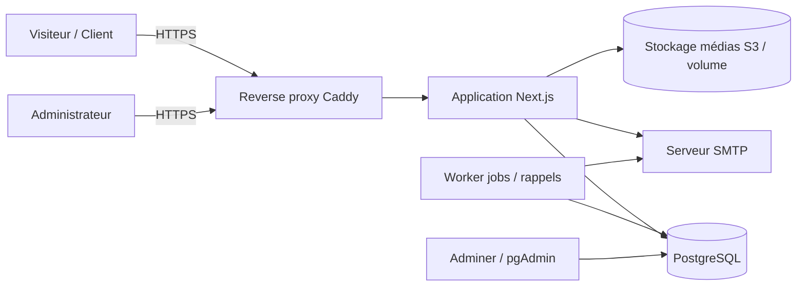
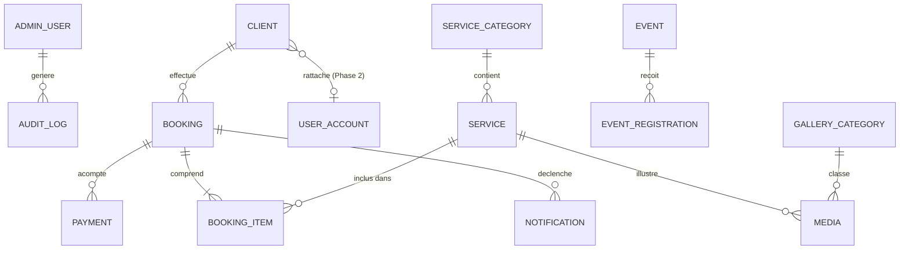
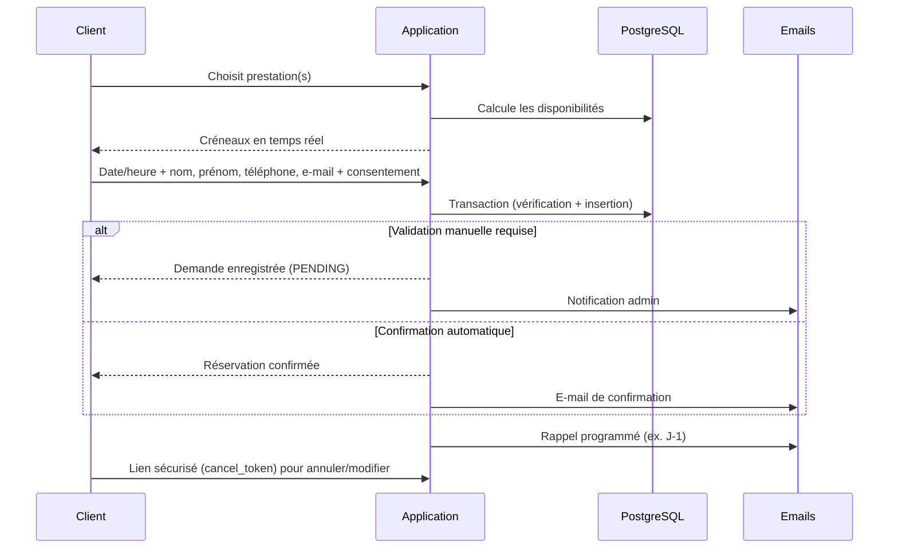

# BeAfro Coiffure & Beauté — Document technique

Version 1.0 — Basé sur le cahier des charges structuré (modules M1 à M9, phases 1 à 3).

---

## 1. Objectifs techniques

| Objectif | Traduction technique |
|---|---|
| Réservation intégrée fiable (priorité n°1) | Moteur de disponibilités interne, contrainte SQL anti-chevauchement, transactions |
| Administration autonome (ordinateur + smartphone) | Back-office responsive, rôles, CRUD de tous les contenus |
| Évolutivité (comptes clients en Phase 2, boutique en Phase 3) | Modèle de données anticipé (`client.user_id` nullable), architecture modulaire |
| Lancement local simple | Environnement 100 % Docker (`docker compose up`) |
| Manipulation des données en SQL | Interface web SQL (Adminer ou pgAdmin) incluse dans la stack Docker |
| SEO, performance, RGPD, HTTPS | Rendu serveur (SSR/SSG), optimisation d'images, gestion du consentement, reverse proxy TLS |

---

## 2. Choix de la pile technologique

Trois options retenues. La recommandation est **Option A (Next.js)**, cohérente avec votre maîtrise de React.

### Option A — Next.js + PostgreSQL (recommandée)

| Couche | Choix |
|---|---|
| Framework | Next.js (App Router), TypeScript |
| UI | Tailwind CSS + shadcn/ui, thème sombre par défaut |
| Base de données | PostgreSQL 16 |
| ORM | Prisma (migrations + Prisma Studio) |
| Authentification admin | Auth.js (credentials, sessions cookies httpOnly) |
| Validation | Zod (partagée client/serveur) |
| Calendrier admin | FullCalendar (vues jour/semaine/mois) |
| Emails | Nodemailer (SMTP), templates React Email |
| Tâches planifiées (rappels) | pg-boss (file de jobs sur PostgreSQL) ou cron conteneurisé |
| Tests | Vitest (unitaires), Playwright (E2E) |

- Avantages : une seule base de code front + back, SEO natif (SSR/SSG), vos compétences React réutilisées, écosystème riche, déploiement simple en conteneur.
- Inconvénients : le back-office est à construire (pas d'admin générée), logique serveur à structurer rigoureusement.

### Option B — Laravel + Filament + PostgreSQL/MySQL

| Couche | Choix |
|---|---|
| Framework | Laravel 11 (PHP 8.3) |
| Back-office | Filament (admin générée : CRUD, calendrier, tableaux, exports) |
| Front public | Blade + Livewire/Alpine.js + Tailwind |
| Emails / jobs | Mailables, Queues, Scheduler natifs |
| Authentification | Laravel Breeze / Fortify (prêt pour les comptes clients Phase 2) |

- Avantages : back-office très rapide à produire (M8 quasi natif), jobs/mails/planification intégrés, hébergement mutualisé PHP économique.
- Inconvénients : changement de langage (PHP), front moins « React ».

### Option C — Django + PostgreSQL

| Couche | Choix |
|---|---|
| Framework | Django 5 (Python 3.12) + Django REST Framework (optionnel) |
| Back-office | Django Admin (inclus, personnalisable) |
| Front public | Templates Django + HTMX + Tailwind (ou front React séparé) |
| Jobs | Celery + Redis, ou django-q |
| Authentification | `django.contrib.auth` (comptes clients Phase 2 simples) |

- Avantages : admin incluse, ORM et migrations robustes, très sûr par défaut.
- Inconvénients : back-office esthétiquement basique sans personnalisation, SEO/interactivité front moins fluide qu'avec Next.js.

### Comparatif

| Critère | A — Next.js | B — Laravel + Filament | C — Django |
|---|---|---|---|
| Courbe d'apprentissage (profil React) | Faible | Moyenne | Moyenne |
| Rapidité pour le back-office | Moyenne | Élevée | Élevée |
| SEO / performance front | Excellente | Bonne | Bonne |
| Évolutivité Phase 2/3 | Excellente | Excellente | Excellente |
| Coût d'hébergement | VPS / conteneur | Mutualisé possible | VPS |

> La suite du document est rédigée pour l'Option A. Le schéma de données, l'algorithme de réservation et la stack Docker restent valables pour B et C (seul l'outillage change).

---

## 3. Architecture globale



### Principes

- Monolithe modulaire : un module par domaine (`catalog`, `booking`, `events`, `gallery`, `contact`, `admin`, `clients`).
- Logique métier isolée dans `services/` (indépendante de l'UI) ; Server Actions / Route Handlers fins.
- Toutes les entrées validées avec Zod ; accès base uniquement via Prisma.
- Horodatages stockés en UTC, affichés en `Europe/Paris`.

### Structure de dossiers proposée

```
beafrocoiffure/
├── docker-compose.yml
├── docker-compose.prod.yml
├── .env.example
├── Dockerfile
├── prisma/
│   ├── schema.prisma
│   ├── migrations/
│   └── seed.ts
├── src/
│   ├── app/
│   │   ├── (public)/            # accueil, coiffure, beaute, galerie, evenements, contact
│   │   ├── reservation/         # tunnel de réservation
│   │   ├── admin/               # back-office (protégé)
│   │   ├── legal/               # mentions, confidentialité, CGV/CGR
│   │   └── api/                 # webhooks, endpoints publics (disponibilités)
│   ├── modules/
│   │   ├── booking/             # availability.ts, booking.service.ts, rules.ts
│   │   ├── catalog/
│   │   ├── events/
│   │   ├── gallery/
│   │   ├── notifications/
│   │   └── clients/
│   ├── lib/                     # db, auth, mailer, storage, date
│   └── components/
├── worker/                      # rappels e-mail / jobs planifiés
└── tests/
```

---

## 4. Environnement Docker (exécution locale)

### Services

| Service | Image | Rôle | Port local |
|---|---|---|---|
| `app` | Build du `Dockerfile` (Node 20 alpine) | Application Next.js (mode dev avec hot reload) | 3000 |
| `db` | `postgres:16-alpine` | Base de données (volume persistant) | 5432 |
| `adminer` | `adminer` | **Interface SQL web** pour consulter/modifier les données | 8080 |
| `mailpit` | `axllent/mailpit` | Capture des e-mails (confirmations, rappels) en local | 8025 (UI), 1025 (SMTP) |
| `worker` | Même image que `app` | Rappels et tâches planifiées | — |
| `minio` (optionnel) | `minio/minio` | Stockage compatible S3 pour photos/vidéos | 9000 / 9001 |

Alternative à Adminer : `dpage/pgadmin4` (plus complet : éditeur de requêtes avancé, diagrammes). Prisma Studio (`npx prisma studio`) reste disponible pour une édition visuelle table par table.

### Exemple de `docker-compose.yml`

```yaml
services:
  db:
    image: postgres:16-alpine
    environment:
      POSTGRES_USER: beafro
      POSTGRES_PASSWORD: beafro_dev
      POSTGRES_DB: beafro
    volumes:
      - pgdata:/var/lib/postgresql/data
    ports: ["5432:5432"]
    healthcheck:
      test: ["CMD-SHELL", "pg_isready -U beafro"]
      interval: 5s
      retries: 10

  adminer:
    image: adminer
    ports: ["8080:8080"]
    environment:
      ADMINER_DEFAULT_SERVER: db
    depends_on: [db]

  mailpit:
    image: axllent/mailpit
    ports: ["8025:8025", "1025:1025"]

  app:
    build: .
    command: npm run dev
    env_file: .env
    ports: ["3000:3000"]
    volumes:
      - .:/app
      - /app/node_modules
    depends_on:
      db:
        condition: service_healthy

  worker:
    build: .
    command: npm run worker
    env_file: .env
    depends_on:
      db:
        condition: service_healthy

volumes:
  pgdata:
```

### Démarrage

```bash
cp .env.example .env
docker compose up -d --build
docker compose exec app npx prisma migrate dev
docker compose exec app npx prisma db seed
```

| URL | Usage |
|---|---|
| http://localhost:3000 | Site public |
| http://localhost:3000/admin | Back-office |
| http://localhost:8080 | Adminer (serveur `db`, utilisateur `beafro`, base `beafro`) |
| http://localhost:8025 | Boîte mail de test (Mailpit) |

---

## 5. Modèle de données



### Tables principales

| Table | Champs clés | Remarque |
|---|---|---|
| `admin_user` | id, email, password_hash, role, last_login | Mot de passe haché (argon2/bcrypt) |
| `user_account` | id, email, password_hash, email_verified | **Vide en Phase 1** ; prête pour la Phase 2 |
| `client` | id, first_name, last_name, phone, email, `user_account_id` **nullable**, consent_at | Réservation sans compte ; rattachement ultérieur par e-mail |
| `service_category` | id, name, universe (`HAIR` \| `WELLNESS`), position | 8 catégories coiffure + testing/accompagnement |
| `service` | id, category_id, title, description, video_url, price_cents, price_mode (`FIXED` \| `QUOTE`), duration_min, conditions, requires_validation, deposit_cents, is_active | Durée = base du moteur |
| `booking` | id, client_id, status, starts_at, ends_at, location_type, notes, cancel_token, source (`ONLINE` \| `ADMIN`), created_at | Statuts : `PENDING`, `CONFIRMED`, `CANCELLED`, `COMPLETED`, `NO_SHOW` |
| `booking_item` | booking_id, service_id, duration_min, price_cents | Copie des valeurs au moment de la réservation |
| `working_hours` | weekday, start_time, end_time | Plages hebdomadaires |
| `time_off` | id, starts_at, ends_at, reason, type (`HOLIDAY` \| `BLOCK`) | Congés, absences, blocages manuels |
| `setting` | key, value (JSON) | Pause entre prestations, délai minimum, politique d'annulation, acompte… |
| `payment` | id, booking_id, provider, amount_cents, status | Optionnel Phase 1, requis si acompte |
| `event` | id, title, description, starts_at, location, price_cents, capacity, is_published | |
| `event_registration` | id, event_id, name, email, phone, status | Contrôle du nombre de places |
| `media` | id, type (`IMAGE` \| `VIDEO`), url, gallery_category_id, service_id, is_before_after, position | Galerie M5 |
| `review` | id, author, rating, text, status (`PENDING` \| `APPROVED`) | Modération manuelle |
| `contact_message` | id, name, email, message, created_at, handled | |
| `notification` | id, booking_id, type, channel, scheduled_at, sent_at, status | Journal et file d'envoi |
| `audit_log` | id, admin_id, action, entity, entity_id, created_at | Traçabilité admin |
| `page_content` | key, locale, content (JSON/Markdown) | Textes modifiables (accueil, beauté, etc.) |

### Anticipation Phase 2/3

- `client.user_account_id` nullable : un client ayant réservé sans compte pourra rattacher son historique à la création du compte.
- Tables futures : `hair_profile`, `care_note`, `loyalty_account`, `referral`, `product`, `order`, `gift_card`, `community_post` (sans impact sur les tables existantes).

---

## 6. Moteur de réservation (M3)

### 6.1 Calcul de la durée

```
durée_totale = Σ durée(prestations sélectionnées)
bloc_occupé  = durée_totale + pause_entre_prestations
```

### 6.2 Génération des créneaux disponibles

1. Récupérer les `working_hours` du jour demandé.
2. Soustraire `time_off` (congés, blocages) et les `booking` actifs (`PENDING`, `CONFIRMED`).
3. Découper les plages libres en créneaux (pas paramétrable, ex. 15/30 min) compatibles avec `bloc_occupé`.
4. Exclure les créneaux antérieurs à `now + délai_minimum`.
5. Retourner les créneaux en UTC ; l'affichage est converti en `Europe/Paris`.

### 6.3 Prévention des doubles réservations (double barrière)

- **Applicative** : revalidation de la disponibilité dans la transaction de création.
- **Base de données** : contrainte d'exclusion PostgreSQL.

```sql
CREATE EXTENSION IF NOT EXISTS btree_gist;

ALTER TABLE booking
  ADD CONSTRAINT booking_no_overlap
  EXCLUDE USING gist (tstzrange(starts_at, ends_at, '[)') WITH &&)
  WHERE (status IN ('PENDING', 'CONFIRMED'));
```

En cas de conflit, l'API renvoie une erreur `409` et l'interface propose de nouveaux créneaux.

### 6.4 Parcours client



### 6.5 Règles de gestion paramétrables (table `setting`)

| Règle | Clé |
|---|---|
| Temps de pause entre prestations | `booking.buffer_minutes` |
| Délai minimum avant réservation | `booking.min_notice_hours` |
| Pas des créneaux | `booking.slot_step_minutes` |
| Délai limite d'annulation/modification | `booking.cancel_limit_hours` |
| Validation manuelle (par prestation) | `service.requires_validation` |
| Acompte (par prestation) | `service.deposit_cents` |
| Horizon de réservation | `booking.max_advance_days` |

### 6.6 Outils administrateur

- Calendrier jour / semaine / mois (FullCalendar), drag & drop pour déplacer un RDV.
- Création manuelle d'un RDV (`source = ADMIN`), modification, annulation.
- Gestion des horaires hebdomadaires, congés, absences, blocages ponctuels.
- Fiche client (coordonnées, RDV passés et à venir).

---

## 7. Notifications

| Événement | Destinataire | Canal Phase 1 |
|---|---|---|
| Demande / confirmation de réservation | Client | E-mail |
| Nouvelle réservation, annulation | Administrateur | E-mail |
| Rappel avant RDV | Client | E-mail (SMS en option) |
| Modification / annulation | Client | E-mail |
| Inscription à un événement | Participant + administrateur | E-mail |

- Les envois passent par la table `notification` (file) traitée par le `worker` ; reprise automatique en cas d'échec.
- Fournisseur SMTP en production : Brevo, Resend, Scaleway TEM ou équivalent. En local : Mailpit.
- SMS (à confirmer avec le client) : OVH SMS ou Twilio, activable par configuration.

---

## 8. Paiement en ligne (acompte)

- Phase 1 : non bloquant ; le modèle `payment` et le champ `deposit_cents` sont déjà présents.
- Si le client confirme le besoin : intégration Stripe Checkout + webhook (`/api/webhooks/stripe`) qui passe la réservation de `PENDING` à `CONFIRMED`.
- Libération automatique du créneau si l'acompte n'est pas réglé sous un délai défini.

---

## 9. Contenus, médias et SEO

### Médias

- Upload depuis l'administration (images : redimensionnement et conversion WebP/AVIF avec `sharp` ; vidéos : taille et format contrôlés).
- Stockage : volume Docker en local, stockage objet S3-compatible (Scaleway, Cloudflare R2) en production.
- Vidéos lourdes : diffusion via stockage objet/CDN, chargement différé (lazy loading).

### SEO

- Rendu serveur/statique, métadonnées par page (`generateMetadata`), `sitemap.xml`, `robots.txt`.
- Données structurées Schema.org : `HairSalon` / `LocalBusiness`, `Service`, `Event`, `Review`.
- URLs lisibles (`/coiffure/depart-de-locks`), balises Open Graph, images avec `alt`.
- Objectifs Lighthouse : Performance ≥ 90, SEO ≥ 95, Accessibilité ≥ 90.

### Direction artistique (M1)

- Thème sombre : fond noir dominant, texte blanc, accent doré/chaud à valider avec le logo.
- Typographie moderne (ex. police sans-serif géométrique pour les titres, lisible pour le texte), via `next/font`.
- Mobile first ; bouton « Prendre rendez-vous » persistant dans l'en-tête et en bas d'écran sur mobile.

---

## 10. Sécurité et conformité

### Sécurité

| Sujet | Mesure |
|---|---|
| Authentification admin | Mot de passe haché argon2/bcrypt, sessions httpOnly + SameSite, limitation des tentatives, 2FA envisageable |
| Autorisations | Contrôle de rôle côté serveur sur chaque action admin |
| Injections | Requêtes paramétrées (Prisma), validation Zod, échappement par défaut de React |
| CSRF / XSS | Protection native des Server Actions, en-têtes CSP, assainissement du contenu riche |
| Abus | Rate limiting sur réservation et contact, anti-spam (honeypot / Turnstile) |
| Liens client | `cancel_token` aléatoire non devinable (≥ 128 bits) pour annuler/modifier |
| Transport | HTTPS obligatoire (Caddy + Let's Encrypt en production), HSTS |
| Secrets | Variables d'environnement, jamais dans le dépôt (`.env` ignoré, `.env.example` fourni) |
| Base de données | Utilisateur dédié à moindres privilèges, non exposée sur Internet en production |
| Sauvegardes | `pg_dump` quotidien chiffré, rétention 14–30 jours, copie hors serveur, test de restauration trimestriel |
| Traçabilité | `audit_log` des actions administrateur |

### RGPD

- Consentement explicite à la collecte (case non pré-cochée) sur réservation, contact et inscription ; date enregistrée (`consent_at`).
- Données minimales collectées ; durée de conservation définie (ex. 3 ans après le dernier RDV).
- Droits d'accès, de rectification et de suppression : export et anonymisation depuis l'administration.
- Cookies : uniquement techniques par défaut (pas de bandeau requis) ; bandeau de consentement si outil d'analyse ou pixel réseau social.
- Pages légales : mentions légales, politique de confidentialité, CGV/CGR, éditables depuis l'administration.
- Le contenu « Beauté & Bien-être » comporte la mention : conseil non médical.

---

## 11. Back-office (M8)

| Section | Fonctions |
|---|---|
| Tableau de bord | RDV du jour et à venir, demandes à valider, derniers messages |
| Planning | Calendrier, horaires, congés, blocages, ajout/modification/annulation |
| Prestations | CRUD catégories et prestations (tarif, durée, vidéo, conditions, activation) |
| Clients | Liste, recherche, fiche détaillée, historique |
| Galerie | Upload, catégories, avant/après, ordre d'affichage |
| Événements | CRUD, liste d'inscrits, jauge de places |
| Avis | Modération (approuver / refuser) |
| Contenus | Textes des pages, coordonnées, réseaux sociaux, pages légales |
| Statistiques | Réservations par période, prestations les plus demandées, chiffre d'affaires, export CSV |
| Paramètres | Règles de réservation, e-mails, compte administrateur |

Contraintes : interface responsive (usage smartphone), actions fréquentes à ≤ 2 clics, confirmations sur actions destructives.

---

## 12. Points d'API / routes principales

| Méthode | Route | Description | Accès |
|---|---|---|---|
| GET | `/api/services` | Catalogue de prestations | Public |
| GET | `/api/availability?services=…&date=…` | Créneaux disponibles | Public |
| POST | `/api/bookings` | Création d'une réservation | Public (rate limit) |
| GET/POST | `/api/bookings/[token]` | Consultation / annulation / demande de modification | Lien sécurisé |
| GET | `/api/events` · POST `/api/events/[id]/register` | Événements et inscription | Public |
| POST | `/api/contact` | Formulaire de contact | Public (anti-spam) |
| `*` | `/admin/**` (Server Actions) | Gestion complète | Administrateur |
| POST | `/api/webhooks/stripe` | Confirmation d'acompte | Signé |

---

## 13. Qualité, tests et CI

| Niveau | Outil | Périmètre prioritaire |
|---|---|---|
| Unitaires | Vitest | Calcul de disponibilités, règles de pause, délais, annulation |
| Intégration | Vitest + base PostgreSQL de test (conteneur) | Contrainte anti-chevauchement, concurrence (2 réservations simultanées) |
| E2E | Playwright | Parcours réservation complet, connexion admin, responsive |
| Qualité | ESLint, Prettier, `tsc --noEmit` | Pré-commit (Husky) |
| CI | GitHub Actions | Lint, tests, build de l'image Docker |

---

## 14. Déploiement en production

| Élément | Proposition |
|---|---|
| Hébergement | VPS (Scaleway, OVH, Hetzner) avec Docker Compose — hébergement UE conseillé pour le RGPD |
| Reverse proxy | Caddy (HTTPS automatique, redirection `www`) |
| Nom de domaine | `www.beafrocoiffure.fr` |
| Services | `app`, `worker`, `db`, `caddy` ; Adminer/pgAdmin **non exposé** (ou derrière VPN / authentification) |
| Stockage médias | Objet S3-compatible |
| Supervision | Healthcheck, logs centralisés, alertes d'indisponibilité (UptimeRobot ou équivalent) |
| Sauvegardes | Cron `pg_dump` + sauvegarde des médias |
| Déploiement | Build d'image en CI, `docker compose pull && up -d`, migrations Prisma au démarrage |

Alternative managée : Vercel + PostgreSQL managé (Neon/Supabase) + stockage objet ; plus simple à exploiter, avec un coût récurrent et une moindre maîtrise.

---

## 15. Plan de réalisation

| Étape | Contenu | Phase |
|---|---|---|
| 0 | Initialisation du dépôt, Docker, Prisma, CI, thème de base | 1 |
| 1 | Modèle de données, seed (catégories et prestations de départ) | 1 |
| 2 | Catalogue de prestations (public + admin) | 1 |
| 3 | Moteur de disponibilités, tunnel de réservation, contrainte SQL | 1 |
| 4 | Calendrier admin, horaires, congés, blocages | 1 |
| 5 | Notifications e-mail et rappels (worker) | 1 |
| 6 | Accueil, espace Beauté & Bien-être, galerie, événements, contact | 1 |
| 7 | Pages légales, RGPD, SEO, performance, sécurité | 1 |
| 8 | Recette, sauvegardes, mise en production | 1 |
| 9 | Comptes clients, historique, recommandations, fidélité | 2 |
| 10 | Boutique, cartes-cadeaux, espace communautaire, statistiques avancées | 3 |

---

## 16. Hypothèses et points à confirmer

| Point du cahier des charges | Hypothèse technique retenue |
|---|---|
| Un seul praticien | Un seul calendrier ; ajout d'une table `resource` possible si plusieurs intervenants |
| Lieu (domicile / salon / itinérant) | Champ `location_type` + adresse sur `booking` ; non bloquant |
| Rappels SMS ou e-mail | E-mail en Phase 1 ; SMS activable selon budget |
| Acompte | Modèle prêt ; intégration Stripe si confirmé |
| Avis clients | Saisie interne avec modération manuelle |
| Contenus (photos, vidéos, textes, logo) | Fournis par le client ; logo disponible (`BE AFRO.png`, `.psd`) |
| Hébergement et budget | VPS + Docker (proposition) ; à valider |
| Langue | Français uniquement ; structure `locale` prévue dans `page_content` |
